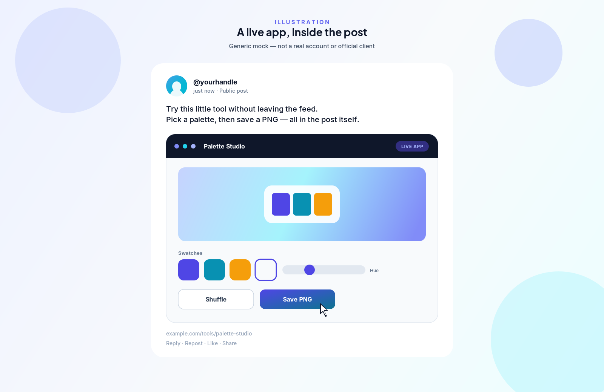
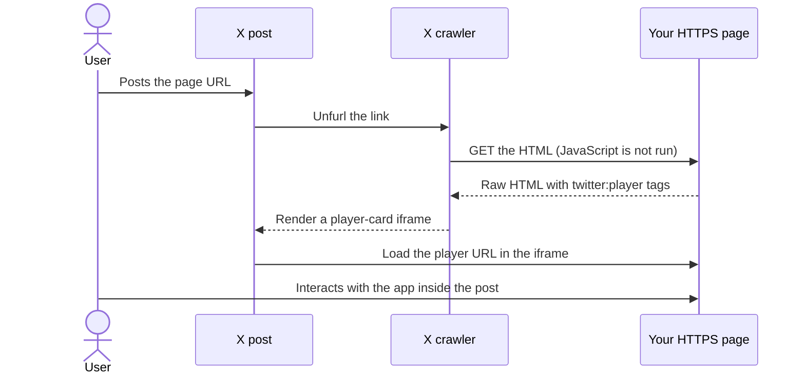
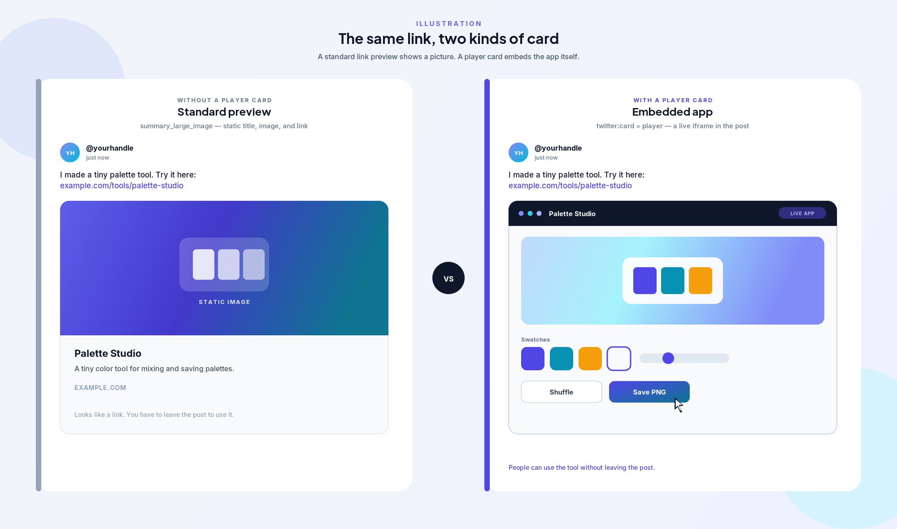

<p align="center">
  
</p>

<h1 align="center">X player card skill</h1>

<p align="center">
  <strong>Build a small web app that runs inside an X post.</strong>
</p>

<p align="center">
  <a href="LICENSE"></a>
  
  
</p>

<p align="center">
  
</p>
<p align="center">
  <em>Illustration — a player card embeds a live app in the post. Generic mock, not a real account or official client.</em>
</p>

An X post cannot host your code. It links to a public HTTPS page whose HTML declares a **player card**. X then loads that page in an iframe inside the post, so people can use the tool without leaving the feed.

This repository is an agent skill: copy `SKILL.md` into your agent's skills folder and ask the agent to build or adapt the app. The skill is stack-agnostic.

## How it works



<p align="center">
  
</p>
<p align="center">
  <em>Illustration — the same link as a standard preview (left) versus a player card (right).</em>
</p>

## Quick start

Copy the skill file into the skills directory your agent already loads. The source in this repo is `skills/x-player-card-app/SKILL.md`. Restart or refresh the agent if it only discovers skills at startup.

### Cursor

```bash
mkdir -p .cursor/skills/x-player-card-app
cp skills/x-player-card-app/SKILL.md .cursor/skills/x-player-card-app/SKILL.md
```

### Claude Code

```bash
mkdir -p ~/.claude/skills/x-player-card-app
cp skills/x-player-card-app/SKILL.md ~/.claude/skills/x-player-card-app/SKILL.md
```

### Other agents

Copy the `x-player-card-app` folder (it must contain `SKILL.md`) into that agent's skills directory, then reload the agent. The exact path varies; the file name and frontmatter (`name` and `description`) are what most agents use to find it.

## Example prompt

Once the skill is installed, paste something like this:

```text
Help me build a small web app that can run inside an X post using a
player card. Follow the x-player-card-app skill.

The app should: [describe the tool, e.g. "a palette mixer with shuffle
and a button that downloads a PNG"].

Use this stack if possible: [HTML, React, Next.js, Angular, Vue, …].
The public URL will be: [https://example.com/tools/slug].
Use @handle for twitter:site.
```

## The three requirements

These are the same on every stack:

1. **The card tags are in the raw HTML** the server returns. X's crawler does not run JavaScript, so tags injected on the client (`react-helmet`, Angular `Meta` without SSR, and similar) are invisible to it. Put them in `index.html`, or render them with SSR or prerendering.
2. **The page can be framed by X.** Do not send `X-Frame-Options: DENY` or `SAMEORIGIN`. Send a CSP `frame-ancestors` list that includes X.
3. **Everything is HTTPS with absolute URLs** — the page, `twitter:player`, and the preview image.

## Supported stacks

| Stack | How the tags get into the raw HTML |
| --- | --- |
| Plain HTML / static site | Put the `<meta>` tags directly in the page `<head>`. |
| React (Vite, CRA, SPA) | Put the tags in `index.html`. For several tools, use multiple HTML entries or prerender. Client-only `react-helmet` is not enough. |
| Next.js | App Router: `metadata` / `generateMetadata`, with player tags in `metadata.other`. Pages Router: `next/head` (server-rendered). |
| Angular | Tags in `src/index.html`, or SSR / prerender plus the `Meta` service. `Meta` alone in the browser is not enough. |
| Vue / Nuxt | Vue SPA: tags in `index.html`. Nuxt: `useSeoMeta` / `useHead` with SSR or `nuxi generate`. |
| Svelte / SvelteKit | SvelteKit: `<svelte:head>` with SSR or `prerender = true`. Plain Svelte: tags in `index.html`. |
| Astro | Tags in the page or layout `<head>`. Static HTML by default, so crawlers see them. |
| SSR backends (Express, Django, Rails, Laravel, Go, …) | Render the tags in the template and set the CSP header on the response. |

## Host headers

| Host | Where to set `Content-Security-Policy` |
| --- | --- |
| Vercel | `vercel.json` `headers`, or the framework config (`next.config.js`, etc.). |
| Netlify | `_headers` file (`/*` then the CSP line). |
| Cloudflare Pages | `_headers` file, same format as Netlify. |
| GitHub Pages | Custom headers are not supported. It usually sends no `X-Frame-Options`, so framing often works, but you cannot add the CSP. |
| nginx | `add_header Content-Security-Policy "frame-ancestors …" always;` and make sure nothing adds `X-Frame-Options`. |

## Minimal example

```html
<meta name="twitter:card" content="player">
<meta name="twitter:site" content="@handle">
<meta name="twitter:title" content="Palette Studio">
<meta name="twitter:description" content="Mix a palette and save a PNG.">
<meta name="twitter:image" content="https://example.com/preview.png">
<meta name="twitter:player" content="https://example.com/tools/palette-studio">
<meta name="twitter:player:width" content="1200">
<meta name="twitter:player:height" content="900">
<meta property="og:title" content="Palette Studio">
<meta property="og:description" content="Mix a palette and save a PNG.">
<meta property="og:image" content="https://example.com/preview.png">
<meta property="og:url" content="https://example.com/tools/palette-studio">
```

```http
Content-Security-Policy: frame-ancestors 'self' https://x.com https://twitter.com https://*.x.com https://*.twitter.com
```

Do not send `X-Frame-Options`. `twitter:player` may be the same page or a dedicated `/embed` route. Width and height set the iframe aspect ratio; design the UI for that frame and for narrower mobile widths, with no horizontal scroll, no popups, and downloads via `<a download>` or a Blob.

## Verify

```bash
# The raw HTML must include every twitter: and og: tag, with absolute HTTPS URLs.
curl -sL https://example.com/tools/palette-studio | grep -E 'twitter:|og:'

# Framing headers: allow X, and do not block iframes.
curl -sI https://example.com/tools/palette-studio
```

If `grep` prints nothing, the tags are being added on the client. Fix that with `index.html`, prerender, or SSR. On the response headers, confirm there is a `frame-ancestors` policy that includes X, and that `X-Frame-Options` is absent. Then load the page in a local test iframe before you post the URL.

## Troubleshooting

**The post shows a normal link preview, not the app.**
This is common. X caches cards (try a new path or `?v=2` after a change). Player cards may also need X to validate or whitelist the domain; until that happens, a correct page often still appears as a regular summary or image preview. Check the tags and headers with `curl` first, then treat cache and approval as the likely remaining causes.

**I set the tags in JavaScript, but `curl` does not show them.**
X's crawler does not run JavaScript. Move the tags into the HTML the server returns.

**The iframe is blank or refused.**
A restrictive `X-Frame-Options` or `frame-ancestors` value, mixed content, or a login wall / bot challenge inside the frame will block the player even when the meta tags look right.

**GitHub Pages.**
You cannot set a custom CSP there. Framing often still works if no `X-Frame-Options` header is sent.

## Repository structure

```text
.
├── LICENSE
├── README.md
├── assets/
│   ├── logo.svg
│   ├── logo.png
│   ├── logo-256.png
│   ├── logo-dark.svg
│   ├── logo-dark.png
│   ├── logo-dark-256.png
│   ├── post-with-player.svg
│   ├── post-with-player.png
│   ├── without-vs-with.svg
│   └── without-vs-with.png
└── skills/
    └── x-player-card-app/
        └── SKILL.md
```

The visuals in `assets/` are original illustrations, not screenshots of a live product.

## Contributing

Issues and pull requests are welcome. Please keep the skill stack-agnostic, leave the three requirements accurate, and do not rely on client-only tag injection. Keep the README and skill text generic (no personal handles or product shout-outs in the examples). If you change a visual, edit the SVG source and re-export the PNG.

## License

[MIT](LICENSE) — copyright the contributors.
